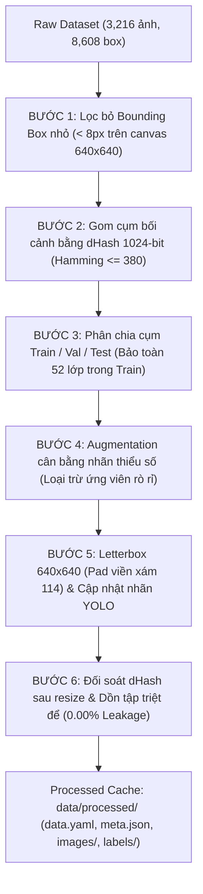

# Phân tích Khám phá Dữ liệu (EDA) & Tiền xử lý Dữ liệu Offline

Tài liệu mô tả chi tiết 2 quy trình cốt lõi thuộc giai đoạn chuẩn bị dữ liệu trong dự án **TSD-Voice-Alert** (Hệ thống Phát hiện Biển báo Giao thông & Cảnh báo Giọng nói Thông minh):
1. **Khám phá & Phân tích Dữ liệu (Exploratory Data Analysis - EDA)** trên tập ảnh thô (`data/raw`) và tập sau tiền xử lý (`data/processed`).
2. **Quy trình Tiền xử lý Offline 6 Bước (Offline Preprocessing Pipeline)** tạo bộ nhớ đệm (cache) chuẩn hóa $640 \times 640$, bảo toàn 52 lớp biển báo và triệt tiêu hoàn toàn rò rỉ dữ liệu (0.00% Data Leakage).

---

## 1. Danh mục 52 Lớp Biển báo & Ngữ âm Cảnh báo (`configs/classes.csv`)

Hệ thống quản lý thống nhất 52 lớp biển báo giao thông Việt Nam theo quy chuẩn **QCVN 41:2019/BGTVT**, được định nghĩa tại `configs/classes.csv` với 3 trường thông tin:
- `id`: Mã lớp (0 - 51) sử dụng thống nhất cho cả YOLO và Faster R-CNN (Faster R-CNN tự động đánh số background = 52 ở head phân loại).
- `name`: Tên tiếng Việt chính quy của biển báo (khớp `data/raw/classes_vie.txt`).
- `tts_text`: Chuỗi ngữ âm tiếng Việt tự nhiên dùng để đọc cảnh báo qua giọng nói (TTS engine: `gTTS` hoặc `pyttsx3`), ví dụ:
  - Lớp 0: `"đường người đi bộ cắt ngang"`
  - Lớp 2: `"cấm đi ngược chiều"`
  - Lớp 10: `"cấm dừng và đỗ xe"`
  - Lớp 38: `"tốc độ tối đa năm mươi ki lô mét một giờ"` (phiên âm dạng chữ để tránh bộ đọc phát âm sai số hoặc đơn vị tiếng Anh).

---

## 2. Quy trình Khám phá Dữ liệu (EDA)

Module phân tích được thiết kế theo kiến trúc module hóa tại thư mục `analysis/`:
- `analysis/helpers/`: Thư viện tính toán dHash 1024-bit loại bỏ viền xám pad 114 (`image_utils.py`), gom cụm bối cảnh (`clustering.py`), kiểm tra rò rỉ dữ liệu (`leakage.py`), phân bố nhãn (`class_distribution.py`), hình học bounding box (`box_metrics.py`), chất lượng quang học (`quality.py`).
- `analysis/eda_raw.py`: Chuyên trách sinh bộ 8 biểu đồ chuẩn cho tập thô (`analysis/figures/raw/`).
- `analysis/eda_processed.py`: Chuyên trách sinh bộ 9 biểu đồ chuẩn cho tập sau xử lý (`analysis/figures/processed/`).
- `analysis/eda.py`: Router tự nhận diện cấu trúc thư mục, đồng thời cung cấp các hàm `class_distribution()`, `box_size_stats()`, `center_heatmap()` cho `notebooks/01_data_analysis.ipynb`.

### 2.1. Phân tích Dữ liệu Thô (RAW Dataset - 8 Biểu đồ)
Dữ liệu thô gồm 3.216 ảnh với 8.608 bounding box. Phân tích rút ra các đặc tính quan trọng:
1. **01_class_distribution.png**: Phân bố nhãn mất cân bằng nghiêm trọng (Long-tail distribution). Lớp nhiều nhất (P.130 - Cấm dừng và đỗ xe) có 985 box, trong khi lớp ít nhất (Camera) chỉ có 9 box (chênh lệch hơn 100 lần). Biểu đồ sử dụng thang đo đối xứng `symlog` để trực quan hóa rõ cả lớp đa số và lớp cực hiếm.
2. **02_boxes_per_image.png**: Đa số ảnh chứa từ 1 đến 3 biển báo, cá biệt có ảnh chứa tới 10-15 biển báo trên cùng một khung hình giao thông.
3. **03_box_dimensions.png**: Kích thước box chiếm tỉ lệ nhỏ so với toàn khung hình (trung bình dưới 5% diện tích ảnh). Theo thang đo MS-COCO, hơn 75% biển báo thuộc nhóm Small Objects ($< 32 \times 32\text{px}$) và Medium Objects ($32^2 - 96^2\text{px}$).
4. **04_box_center_heatmap.png**: Mật độ vị trí tâm box tập trung lệch mạnh về nửa bên phải và phần trên của khung hình, hoàn toàn phù hợp với thực tế lắp đặt biển báo giao thông tại Việt Nam (lề đường bên phải và giá long môn).
5. **05_dhash_clusters.png**: Bằng Difference Hash 1024-bit (size 32, khoảng cách Hamming $\le 380$), phát hiện 3.216 ảnh gốc thực chất thuộc về **314 cụm bối cảnh** (trong đó có 123 cụm chứa nhiều ảnh được cắt liên tiếp từ cùng chuỗi video camera hành trình).
6. **06_tiny_box_candidates.png**: Có **811 bounding box nhỏ hơn 8px** trên canvas chuẩn $640 \times 640$. Các box này là nhiễu biên quá mờ, không thể nhận diện ngay cả bằng mắt thường và sẽ gây hại cho gradient trong quá trình huấn luyện.
7. **07_brightness_sharpness.png**: Đánh giá quang học trên 1.000 ảnh mẫu cho thấy độ sáng trung bình đạt 115.5/255, độ sắc nét trung vị Laplacian variance đạt 680.8, trong đó khoảng 3.4% ảnh thuộc điều kiện thiếu sáng hoặc rung mờ.
8. **08_sample_labels.png**: Trực quan hóa 9 ảnh mẫu kèm nhãn bounding box thực tế.

### 2.2. Phân tích Dữ liệu Sau Tiền xử lý (PROCESSED Dataset - 9 Biểu đồ)
1. **01_class_distribution.png**: Phân tách 3 tập Train, Val, Test. Riêng tập Train phân biệt rõ ảnh thật (Real) và ảnh tăng cường (Augmented) bằng 2 màu sắc.
2. **02_boxes_per_image.png**: Phân bố box sau khi đã lọc sạch tiny box.
3. **03_box_dimensions.png**: Kích thước box đo trực tiếp trên canvas chuẩn hóa $640 \times 640$.
4. **04_box_center_heatmap.png**: Bản đồ nhiệt mật độ tâm sau letterbox.
5. **05_images_per_split.png**: So sánh trực quan số lượng ảnh và số box giữa Train, Val, Test.
6. **06_tiny_box_candidates.png**: **Xác nhận 0% box nhỏ** ($< 8\text{px}$) còn sót lại.
7. **07_data_leakage.png**: Ma trận kiểm tra rò rỉ dữ liệu dHash: **0 cặp rò rỉ** giữa Train-Val, Train-Test và Val-Test (Trạng thái: **PASSED - 0.00%**).
8. **08_brightness_sharpness.png**: Phân tích quang học chia thành 3 hàng x 3 cột (Train, Val, Test) chứng minh tính tương đồng phân phối giữa các tập.
9. **09_sample_labels.png**: Demo 9 ảnh mẫu sau letterbox và cập nhật nhãn bounding box.

---

## 3. Quy trình Tiền xử lý Offline 6 Bước (Offline Preprocessing)

Quy trình tiền xử lý được lập trình trong `ts_alert/data/preprocess_offline.py` và gọi qua CLI `tools/run_preprocess.py`.



### Bước 1: Lọc Bounding Box nhỏ (< 8px)
- Với mỗi ảnh thô, tính hệ số tỉ lệ $scale = \min(640 / W_{orig}, 640 / H_{orig})$.
- Nếu $bw \times W_{orig} \times scale < 8\text{px}$ hoặc $bh \times H_{orig} \times scale < 8\text{px}$, box bị loại bỏ.
- Kết quả: Loại bỏ **811 tiny box**, giữ lại **7.797 box hợp lệ**.

### Bước 2: Gom cụm bằng Difference Hash 1024-bit
- Ánh xạ mỗi ảnh thành vector nhị phân 1.024-bit ($32 \times 32$).
- Áp dụng thuật toán gom cụm đồ thị với ngưỡng khoảng cách Hamming $\le 380$.
- Kết quả: 3.216 ảnh được phân rã thành **314 cụm độc lập bối cảnh**.

### Bước 3: Phân chia Cụm Bảo tồn 52 Lớp (Cluster Splitting & Class Preservation)
- Quy tắc nguyên tử: **Toàn bộ ảnh trong cùng một cụm phải thuộc về cùng một tập (Train, Val hoặc Test)** để loại trừ hiện tượng rò rỉ chuỗi video.
- Áp dụng giải thuật tối ưu đa mục tiêu:
  1. Cụm chứa nhãn hiếm (tổng số mẫu $\le 30$) hoặc cụm có kích thước lớn ($> 300$ ảnh) bắt buộc phân vào Train.
  2. Bắt buộc tập **Train phải có mặt đầy đủ 52/52 lớp**.
  3. Cân bằng phân phối độ sáng (ảnh tối) và độ nét (ảnh mờ) giữa các tập.
- Kết quả: Train nhận 2.165 ảnh (đủ 52 lớp), Val nhận 671 ảnh, Test nhận 380 ảnh.

### Bước 4: Augmentation Cân bằng Lớp Thiểu số trong Train
- Chỉ áp dụng trên tập Train nhằm khắc phục hiện tượng mất cân bằng dữ liệu:
  - Xác định vùng cắt an toàn (`get_safe_crop_bounds`) để không cắt đè lên các biển báo khác trong ảnh.
  - Áp dụng biến đổi ngẫu nhiên: zoom nhẹ ($1.0 - 1.3\times$), thay đổi tỉ lệ, dịch chuyển nhẹ bối cảnh, làm mờ nhẹ (Gaussian Blur $3\times 3$).
  - **Cơ chế chống rò rỉ chủ động**: Tính dHash 1024-bit của ảnh sau khi augment; nếu khoảng cách Hamming đến bất kỳ ảnh nào trong tập Val hoặc Test $\le 380$, ảnh ứng viên bị **từ chối ngay lập tức**.
- Kết quả: Sinh thêm **274 ảnh và 274 box** cho 40 lớp thiểu số trong tập Train (trần tối đa 7 ảnh/lớp).

### Bước 5: Letterbox 640x640 (Pad 114)
- Đưa toàn bộ ảnh về kích thước chuẩn $640 \times 640$ mà không làm méo tỉ lệ hình học biển báo:
  $$scale = \min\left(\frac{640}{W}, \frac{640}{H}\right), \quad dx = \frac{640 - \text{round}(W \times scale)}{2}, \quad dy = \frac{640 - \text{round}(H \times scale)}{2}$$
- Vùng đệm được tô màu xám chuẩn YOLO: `(114, 114, 114)`.
- Tọa độ bounding box được chuyển đổi sang hệ tọa độ chuẩn hóa mới của canvas $640 \times 640$.

### Bước 6: Đối soát sau Resize & Dồn tập Triệt tiêu Rò rỉ
- Sau khi letterbox và nén JPEG, nội dung quang học có thể thay đổi nhẹ. Hệ thống tính lại dHash toàn bộ 3.490 ảnh đầu ra (có bóc tách viền xám pad 114 để không nhận nhầm viền xám là tương đồng nội dung).
- Thuật toán duyệt đồ thị rò rỉ:
  - Nếu ảnh trong Val hoặc Test có khoảng cách Hamming $\le 380$ với Train $\rightarrow$ **Dồn về Train** (133 ảnh).
  - Nếu ảnh trong Test có khoảng cách $\le 380$ với Val $\rightarrow$ **Dồn về Val** (12 ảnh).
- Kết quả cuối cùng: **0 cặp rò rỉ dữ liệu giữa tất cả các tập (100% Sạch)**.

---

## 4. Thống kê Bộ Dữ liệu Sau Tiền xử lý

| Tập dữ liệu | Số lượng ảnh | Tỉ lệ ảnh | Số lượng Box | Tỉ lệ Box | Số lớp xuất hiện |
| :--- | :---: | :---: | :---: | :---: | :---: |
| **Train** | 2.572 | 73.7% | 5.589 | 71.7% | **52 / 52** (100%) |
| **Val** | 555 | 15.9% | 1.199 | 15.4% | 40 / 52 |
| **Test** | 363 | 10.4% | 1.009 | 12.9% | 40 / 52 |
| **Tổng cộng** | **3.490** | **100%** | **7.797** | **100%** | **52 / 52** |

- **Cấu hình YOLO (`data/processed/data.yaml`)**:
  ```yaml
  path: E:/BACHKHOA/25_DA_TONG_HOP/TSD-Voice-Alert/TSD-Voice-Alert/data/processed
  train: images/train
  val: images/val
  test: images/test
  nc: 52
  names: {0: "Đường người đi bộ cắt ngang", 1: "Đường giao nhau (ngã ba bên phải)", ...}
  ```
- **Metadata (`data/processed/meta.json`)**: Lưu vết số lượng ảnh, số box, tham số hạt giống (`seed: 42`), kích thước ảnh (`image_size: 640`), và tỉ lệ rò rỉ (`leakage_rate: 0.0`).

---

## 5. Hướng dẫn Chạy Lệnh & Kiểm thử

### 5.1. Chạy Phân tích Khám phá Dữ liệu (EDA)
```bash
# Phân tích tập dữ liệu thô (xuất 8 biểu đồ vào analysis/figures/raw/)
python -m analysis.eda --data-root data/raw

# Phân tích tập dữ liệu sau tiền xử lý (xuất 9 biểu đồ vào analysis/figures/processed/)
python -m analysis.eda --data-root data/processed
```

### 5.2. Chạy Tiền xử lý Dữ liệu Offline
```bash
# Thực hiện toàn bộ pipeline 6 bước tạo cache data/processed/
python -m tools.run_preprocess --data-root data/raw
```

### 5.3. Chạy Kiểm thử Đơn vị (Unit Tests)
```bash
pytest tests/test_preprocess.py -v
```
Kiểm tra:
- `test_letterbox_sample`: Kiểm tra kích thước canvas $640\times 640$, viền pad 114 và độ chính xác chuyển đổi toạ độ YOLO.
- `test_split_samples_no_leakage`: Kiểm tra phân chia không có rò rỉ giữa các tập.
- `test_write_data_yaml`: Kiểm tra cấu trúc file cấu hình Ultralytics YOLO.

---

## 6. Hiện thực Hóa Pipeline Huấn luyện & Suy luận YOLO26m (Thành viên 1)

Song song với quy trình tiền xử lý, pipeline YOLO26m (Ultralytics 8.4.175) đã được hiện thực hoàn chỉnh theo chuẩn hợp đồng dữ liệu:
1. **Nạp mô hình (`ts_alert/pipelines/yolo/model.py`)**:
   - `load_model(weights_or_name)`: Cơ chế nạp muộn (late import) `from ultralytics import YOLO` giúp khởi động Web App và các tác vụ kiểm thử nhẹ không bị tải chậm bởi torch.
2. **Suy luận thời gian thực (`ts_alert/pipelines/yolo/infer.py`)**:
   - `YoloDetector.predict(frame)`: Nhận frame BGR gốc, chạy suy luận YOLO với ngưỡng confidence `conf_threshold` và IoU `iou_threshold`, tự động ánh xạ class index sang tên biển báo tiếng Việt trong `configs/classes.csv`.
   - Kết quả trả về đúng định dạng chuẩn hợp đồng `DATA_CONTRACT`:
     `[{"bbox": [x1, y1, x2, y2], "label": str, "class_id": int, "confidence": float}]`
3. **Quy trình Huấn luyện (`ts_alert/pipelines/yolo/train.py`)**:
   - `YoloPipeline.fit()`: Đọc `data/processed/data.yaml`, cấu hình tổng batch, kích thước ảnh $640\times 640$, seed 42, lưu nhật ký theo dõi vào thư mục chuẩn `outputs/yolo/<run_name>/`, tự động lưu checkpoint tốt nhất vào `models/yolo/best.pt`.
4. **Online Augmentation (`ts_alert/data/preprocess_online.py`)**:
   - `build_online_transforms(cfg, backend="ultralytics")`:
     - Khi `online_preprocess.enabled = false`: Tắt triệt để toàn bộ mosaic, mixup, fliplr, hsv jitter mặc định của Ultralytics nhằm bảo đảm tính công bằng tuyệt đối khi so sánh thực nghiệm với Faster R-CNN trên tập offline letterbox.
     - Khi `online_preprocess.enabled = true`: Kích hoạt mosaic (1.0), mixup (0.15), jitter tỉ lệ và tắt `hflip` (vì biển báo có ý nghĩa định hướng trái/phải).
