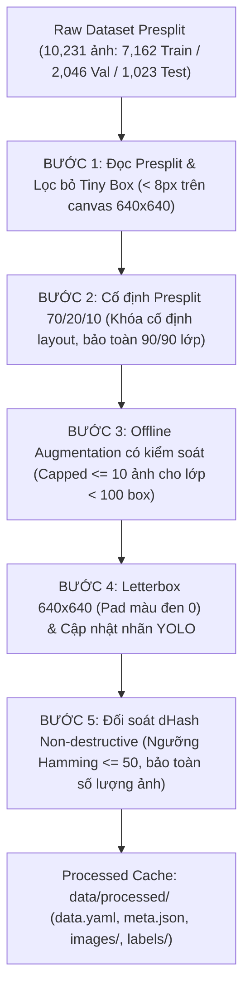

# Phân tích Khám phá Dữ liệu (EDA) & Tiền xử lý Dữ liệu Offline

Tài liệu mô tả chi tiết 2 quy trình cốt lõi thuộc giai đoạn chuẩn bị dữ liệu trong dự án **TSD-Voice-Alert** (Hệ thống Phát hiện Biển báo Giao thông & Cảnh báo Giọng nói Thông minh):
1. **Khám phá & Phân tích Dữ liệu (Exploratory Data Analysis - EDA)** trên tập ảnh thô (`data/raw`) và tập sau tiền xử lý (`data/processed`).
2. **Quy trình Tiền xử lý Offline Chuẩn hóa** tạo bộ nhớ đệm (cache) chuẩn hóa $640 \times 640$, cố định phân chia cố định (Presplit) 70% Train, 20% Val, 10% Test, bảo toàn đầy đủ 90 lớp biển báo và kiểm soát rò rỉ dữ liệu (Data Leakage Control).

---

## 1. Danh mục 90 Lớp Biển báo & Ngữ âm Cảnh báo (`configs/classes.csv`)

Hệ thống quản lý thống nhất 90 lớp biển báo giao thông Việt Nam theo quy chuẩn **QCVN 41:2019/BGTVT**, được định nghĩa tại `configs/classes.csv` với 3 trường thông tin:
- `id`: Mã lớp (0 - 89) sử dụng thống nhất cho cả YOLO và Faster R-CNN (Faster R-CNN tự động đánh số background = 90 ở head phân loại).
- `name`: Tên tiếng Việt chính quy của biển báo (khớp `data/raw/classes_vie.txt`).
- `tts_text`: Chuỗi ngữ âm tiếng Việt tự nhiên dùng để đọc cảnh báo qua giọng nói (TTS engine: `gTTS` hoặc `pyttsx3`), ví dụ:
  - Lớp 0: `"đường người đi bộ cắt ngang"`
  - Lớp 2: `"cấm đi ngược chiều"`
  - Lớp 10: `"cấm dừng và đỗ xe"`
  - Lớp 38: `"tốc độ tối đa năm mươi ki lô mét một giờ"` (phiên âm dạng chữ để tránh bộ đọc phát âm sai số hoặc đơn vị tiếng Anh).
  - Lớp 89: `"cấm ô tô rẽ phải và quay đầu"`

---

## 2. Quy trình Khám phá Dữ liệu (EDA)

Module phân tích được thiết kế theo kiến trúc module hóa tại thư mục `analysis/`:
- `analysis/helpers/`: Thư viện tính toán dHash 1024-bit loại bỏ viền đen pad 0 (`image_utils.py`), gom cụm bối cảnh (`clustering.py`), kiểm tra rò rỉ dữ liệu (`leakage.py`), phân bố nhãn (`class_distribution.py`), hình học bounding box (`box_metrics.py`), chất lượng quang học (`quality.py`).
- `analysis/eda_raw.py`: Chuyên trách sinh bộ 8 biểu đồ chuẩn cho tập thô (`analysis/figures/raw/`).
- `analysis/eda_processed.py`: Chuyên trách sinh bộ 9 biểu đồ chuẩn cho tập sau xử lý (`analysis/figures/processed/`).
- `analysis/eda.py`: Router tự nhận diện cấu trúc thư mục, đồng thời cung cấp các hàm `class_distribution()`, `box_size_stats()`, `center_heatmap()` cho `notebooks/01_data_analysis.ipynb`.

### 2.1. Phân tích Dữ liệu Thô (RAW Dataset - 8 Biểu đồ)
Dữ liệu thô gồm **10.231 ảnh** với **20.114 bounding box** trải dài trên 90 lớp biển báo:
1. **01_class_distribution.png**: Biểu đồ thanh ngang hiển thị đầy đủ cả 90 lớp biển báo (không gộp nhóm "Khác"), thể hiện phân bố mất cân bằng (Long-tail distribution). Biểu đồ sử dụng thang đo đối xứng `symlog` để trực quan hóa rõ cả lớp đa số và lớp cực hiếm.
2. **02_boxes_per_image.png**: Đa số ảnh chứa từ 1 đến 3 biển báo, một số khung hình giao thông phức tạp chứa tới 10-15 biển báo.
3. **03_box_dimensions.png**: Kích thước box chiếm tỉ lệ nhỏ so với toàn khung hình (trung bình dưới 5% diện tích ảnh). Đa số biển báo thuộc nhóm Small Objects ($< 32 \times 32\text{px}$) và Medium Objects ($32^2 - 96^2\text{px}$).
4. **04_box_center_heatmap.png**: Mật độ vị trí tâm box tập trung lệch mạnh về nửa bên phải và phần trên của khung hình, phù hợp với thực tế lắp đặt biển báo giao thông tại Việt Nam (lề đường bên phải và giá long môn).
5. **05_dhash_clusters.png**: Bằng Difference Hash 1024-bit (size 32, khoảng cách Hamming $\le 50$), phát hiện các cụm bối cảnh cảnh quay tương đồng từ camera hành trình.
6. **06_tiny_box_candidates.png**: Lọc bounding box nhỏ hơn 8px trên canvas chuẩn $640 \times 640$ để loại bỏ nhiễu biên quá mờ.
7. **07_brightness_sharpness.png**: Đánh giá quang học phân bố độ sáng và độ sắc nét Laplacian variance trên tập dữ liệu.
8. **08_sample_labels.png**: Trực quan hóa ảnh mẫu kèm nhãn bounding box thực tế.

### 2.2. Phân tích Dữ liệu Sau Tiền xử lý (PROCESSED Dataset - 9 Biểu đồ)
1. **01_class_distribution.png**: Biểu đồ thanh ngang 3 panel (Train, Validation, Test) chung trục Y liệt kê đầy đủ 90 lớp kèm tên tiếng Việt không cắt gọn. Riêng tập Train phân biệt rõ box thật (Real) và box tăng cường (Augmented).
2. **02_boxes_per_image.png**: Phân bố box sau khi đã lọc sạch tiny box.
3. **03_box_dimensions.png**: Kích thước box đo trực tiếp trên canvas chuẩn hóa $640 \times 640$.
4. **04_box_center_heatmap.png**: Bản đồ nhiệt mật độ tâm sau letterbox.
5. **05_images_per_split.png**: So sánh trực quan số lượng ảnh và số box giữa Train, Val, Test theo tỉ lệ chuẩn 70% - 20% - 10%.
6. **06_tiny_box_candidates.png**: Xác nhận 0% box nhỏ ($< 8\text{px}$) còn sót lại.
7. **07_data_leakage.png**: Ma trận kiểm tra rò rỉ dữ liệu dHash giữa Train-Val, Train-Test và Val-Test (ngưỡng Hamming $\le 50$).
8. **08_brightness_sharpness.png**: Phân tích quang học chia thành 3 hàng x 3 cột (Train, Val, Test) chứng minh tính tương đồng phân phối giữa các tập.
9. **09_sample_labels.png**: Demo ảnh mẫu sau letterbox và cập nhật nhãn bounding box.

---

## 3. Quy trình Tiền xử lý Offline (Offline Preprocessing)

Quy trình tiền xử lý được lập trình trong `ts_alert/data/preprocess_offline.py` và gọi qua CLI `tools/run_preprocess.py`.



### Bước 1: Nạp Presplit & Lọc Bounding Box nhỏ (< 8px)
- Kiểm tra chặt chẽ cấu trúc thư mục presplit `data/raw/images/{train,val,test}` và `data/raw/labels/{train,val,test}`.
- Với mỗi ảnh thô, tính hệ số tỉ lệ $scale = \min(640 / W_{orig}, 640 / H_{orig})$.
- Nếu $bw \times W_{orig} \times scale < 8\text{px}$ hoặc $bh \times H_{orig} \times scale < 8\text{px}$, box bị loại bỏ để tránh gây nhiễu gradient khi huấn luyện.

### Bước 2: Cố định Phân chia Tập dữ liệu (Fixed Presplit 70/20/10)
- Tập dữ liệu thô đã được phân chia theo thuật toán phân tầng đa nhãn (Multilabel Iterative Stratification) đạt chính xác tỉ lệ **70% Train, 20% Val, 10% Test**.
- **100% tất cả 90 lớp** đều có mặt ở cả 3 tập (Train, Val, Test), loại bỏ hoàn toàn tình trạng mất cân bằng lớp ở các tập kiểm định và kiểm tra.
- Toàn bộ logic chia split động và gom cụm runtime cũ (`split_samples`, `promote_rare_classes_to_train`) đã được dọn dẹp để đảm bảo tính tái lập và nhất quán tuyệt đối.

### Bước 3: Augmentation Cân bằng Lớp Thiểu số trong Train
- Chỉ áp dụng trên tập Train cho các lớp có số lượng bounding box thật `< 100`.
- Các lớp có $\ge 100$ bounding box thật được giữ nguyên, không áp dụng tăng cường ngoại tuyến.
- **Giới hạn tối đa (Cap)**: Mỗi lớp thiểu số chỉ được sinh tối đa **10 ảnh mới** (`max_augmented_per_class = 10`), tránh làm lệch phân phối tự nhiên.
- Kỹ thuật sinh ảnh (`transform_and_letterbox_crop`): Cắt an toàn (`get_safe_crop_bounds`), co dãn zoom ($0.85 - 1.25\times$), chỉnh sáng nhẹ, giảm làm mờ, không xoay (để giữ nguyên ngữ nghĩa biển báo).
- **Cơ chế chống rò rỉ chủ động**: Tính dHash của ảnh sinh mới; nếu khoảng cách Hamming đến bất kỳ ảnh nào trong tập Val hoặc Test $\le 50$, ảnh ứng viên bị từ chối ngay lập tức.

### Bước 4: Letterbox 640x640 (Pad màu đen 0)
- Đưa toàn bộ ảnh về kích thước chuẩn $640 \times 640$ mà không làm méo tỉ lệ hình học biển báo:
  $$scale = \min\left(\frac{640}{W}, \frac{640}{H}\right), \quad dx = \frac{640 - \text{round}(W \times scale)}{2}, \quad dy = \frac{640 - \text{round}(H \times scale)}{2}$$
- Vùng đệm được tô màu đen đồng nhất với ảnh thô gốc: `pad_value: 0` (`(0, 0, 0)`).
- Tọa độ bounding box được chuyển đổi sang hệ tọa độ chuẩn hóa mới của canvas $640 \times 640$.

### Bước 5: Đối soát sau Resize (Non-destructive dHash Check)
- Sau khi letterbox và nén JPEG, hệ thống tính dHash 1024-bit của toàn bộ ảnh đầu ra (loại bỏ viền pad để đánh giá đúng nội dung).
- Thuật toán kiểm tra rò rỉ theo ngưỡng Hamming $\le 50$.
- Quy trình đối soát hoạt động ở chế độ **không làm biến đổi (non-destructive)**: ghi nhận và tính toán tỉ lệ rò rỉ vào metadata mà **không di chuyển file giữa các split**, bảo toàn tuyệt đối tỉ lệ 70/20/10 và số lớp của từng tập.

---

## 4. Thống kê Bộ Dữ liệu Thô và Cấu hình

| Tập dữ liệu | Số lượng ảnh | Tỉ lệ ảnh | Số lượng Box | Tỉ lệ Box | Số lớp xuất hiện |
| :--- | :---: | :---: | :---: | :---: | :---: |
| **Train** | 7.162 | 70.0% | 14.103 | 70.1% | **90 / 90** (100%) |
| **Val** | 2.046 | 20.0% | 4.017 | 20.0% | **90 / 90** (100%) |
| **Test** | 1.023 | 10.0% | 1.994 | 9.9% | **90 / 90** (100%) |
| **Tổng cộng** | **10.231** | **100%** | **20.114** | **100%** | **90 / 90** (100%) |

- **Cấu hình YOLO (`data/processed/data.yaml`)**:
  ```yaml
  path: E:/BACHKHOA/25_DA_TONG_HOP/TSD-Voice-Alert/TSD-Voice-Alert/data/processed
  train: images/train
  val: images/val
  test: images/test
  nc: 90
  names: {0: "Đường người đi bộ cắt ngang", 1: "Đường giao nhau (ngã ba bên phải)", ...}
  ```
- **Metadata (`data/processed/meta.json`)**: Lưu vết số lượng ảnh, số box, tham số hạt giống (`seed: 42`), kích thước ảnh (`image_size: 640`), cấu hình pad (`pad_value: 0`), và tỉ lệ rò rỉ (`leakage_rate`).

---

## 5. Hướng dẫn Chạy Lệnh & Kiểm thử

### 5.1. Chạy Phân tích Khám phá Dữ liệu (EDA)
```bash
# Phân tích tập dữ liệu thô (xuất 8 biểu đồ vào analysis/figures/raw/)
python -m analysis.eda --data-root data/raw

# Phân tích tập dữ liệu sau tiền xử lý (xuất 9 biểu đồ vào analysis/figures/processed/)
python -m analysis.eda --data-root data/processed
```

### 5.2. Chạy Tiền xử lý Dữ liệu Offline
```bash
# Thực hiện toàn bộ pipeline tiền xử lý tạo cache data/processed/
python -m tools.run_preprocess --data-root data/raw
```

### 5.3. Chạy Kiểm thử Đơn vị (Unit Tests)
```bash
pytest tests/test_preprocess.py -v
```
Kiểm tra:
- `test_letterbox_sample`: Kiểm tra kích thước canvas $640\times 640$, viền pad 0 và độ chính xác chuyển đổi toạ độ YOLO.
- `test_run_preprocess_fixed_splits_no_blur`: Kiểm tra pipeline tiền xử lý giữ cố định presplit (Train/Val/Test), chống rò rỉ dữ liệu và letterbox canvas.
- `test_write_data_yaml`: Kiểm tra cấu trúc file cấu hình Ultralytics YOLO cho 90 lớp.

---

## 6. Hiện thực Hóa Pipeline Huấn luyện & Suy luận YOLO26m (Thành viên 1)

Song song với quy trình tiền xử lý, pipeline YOLO26m (Ultralytics 8.4.175) đã được hiện thực hoàn chỉnh theo chuẩn hợp đồng dữ liệu:
1. **Nạp mô hình (`ts_alert/pipelines/yolo/model.py`)**:
   - `load_model(weights_or_name)`: Cơ chế nạp muộn (late import) `from ultralytics import YOLO` giúp khởi động Web App và các tác vụ kiểm thử nhẹ không bị tải chậm bởi torch.
2. **Suy luận thời gian thực (`ts_alert/pipelines/yolo/infer.py`)**:
   - `YoloDetector.predict(frame)`: Nhận frame BGR gốc, chạy suy luận YOLO với ngưỡng confidence `conf_threshold` và IoU `iou_threshold`, tự động ánh xạ class index sang tên biển báo tiếng Việt trong `configs/classes.csv`.
   - Kết quả trả về đúng định dạng chuẩn hợp đồng `DATA_CONTRACT`:
     `[{"bbox": [x1, y1, x2, y2], "label": str, "class_id": int, "confidence": float}]`
3. **Quy trình Huấn luyện (`ts_alert/pipelines/yolo/train.py`)**:
   - `YoloPipeline.fit()`: Đọc `data/processed/data.yaml`, cấu hình tổng batch, kích thước ảnh $640\times 640$, seed 42, lưu nhật ký theo dõi vào thư mục chuẩn `outputs/yolo/<run_name>/`, tự động lưu checkpoint tốt nhất vào `models/yolo/best.pt`.
4. **Online Augmentation (`ts_alert/data/preprocess_online.py`)**:
   - `build_online_transforms(cfg, backend="ultralytics")`:
     - Khi `online_preprocess.enabled = false`: Tắt triệt để toàn bộ mosaic, mixup, fliplr, hsv jitter mặc định của Ultralytics nhằm bảo đảm tính công bằng tuyệt đối khi so sánh thực nghiệm với Faster R-CNN trên tập offline letterbox.
     - Khi `online_preprocess.enabled = true`: Kích hoạt mosaic (1.0), mixup (0.15), jitter tỉ lệ và tắt `hflip` (vì biển báo có ý nghĩa định hướng trái/phải).
