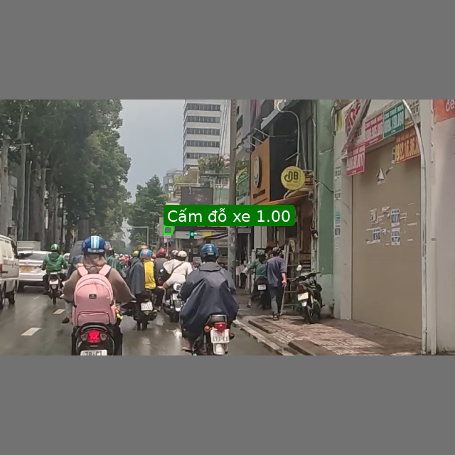
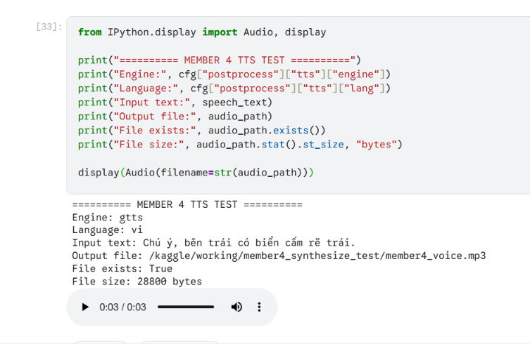

# Post-processing & Voice Alert

Tài liệu mô tả các chức năng hậu xử lý và cảnh báo bằng giọng nói trong hệ thống TSD-Voice-Alert.

**Phụ trách:** Thành viên 4 – Layer & Voice.

**Thư mục mã nguồn:** `ts_alert/postprocess/`

## 1. Tổng quan

Sau khi mô hình YOLO hoặc Faster R-CNN phát hiện biển báo giao thông, hệ thống cần xử lý thêm kết quả nhận diện trước khi đưa ra cảnh báo cho người dùng.

Thành viên 4 phụ trách 5 chức năng chính:

| File            | Chức năng                                        |
| --------------- | ------------------------------------------------ |
| `position.py`   | Xác định vị trí biển báo trong khung hình        |
| `draw_layer.py` | Vẽ bounding box và nhãn lên hình ảnh             |
| `dedup.py`      | Theo dõi và chống cảnh báo trùng lặp             |
| `tts.py`        | Tạo nội dung cảnh báo và chuyển thành giọng nói  |
| `merge_av.py`   | Ghép âm thanh vào video theo thời điểm phát hiện |

Mục tiêu là giúp hệ thống không chỉ nhận diện được biển báo mà còn có thể hiển thị và cảnh báo bằng giọng nói một cách phù hợp.

## 2. Luồng xử lý

Các module được gọi trong `ts_alert/pipeline.py::process_media`.

```text
Detector.predict(frame)
        |
        v
position.add_positions()
        |
        v
repo.add_detections()
        |
        v
Deduplicator.update()
        |
        +----------------------+
        |                      |
        v                      v
draw_layer.draw_       tts.build_speech_text()
detections()                    |
        |                       v
        |               tts.synthesize()
        |                       |
        v                       v
VideoWriter.write()      audio_events
        |                       |
        +-----------+-----------+
                    |
                    v
       merge_av.merge_audio_video()
                    |
                    v
           Final output video
```

Luồng trên giúp tách biệt các nhiệm vụ: xác định vị trí, hiển thị kết quả, quyết định khi nào cần đọc cảnh báo và tạo video có âm thanh.

## 3. Chi tiết từng module

### 3.1. Position – Xác định vị trí biển báo

**File:** `ts_alert/postprocess/position.py`

**Mục đích:**

Xác định biển báo nằm ở bên trái, phía trước hay bên phải so với người quan sát dựa trên tọa độ bounding box.

**Hàm chính:**

```python
get_position(bbox, frame_width, cfg) -> str
add_positions(detections, frame_width, cfg) -> list
```

**Cách xử lý:**

Tính tâm theo chiều ngang của bounding box:

```text
center_x = (x1 + x2) / 2
ratio = center_x / frame_width
```

Sau đó so sánh tỷ lệ với hai ngưỡng trong cấu hình:

* `ratio < left_max`: biển báo ở bên trái.
* `left_max <= ratio < right_min`: biển báo ở phía trước.
* `ratio >= right_min`: biển báo ở bên phải.

**Cấu hình hiện tại:**

```yaml
postprocess:
  position:
    left_max: 0.33
    right_min: 0.66
```

Hàm `add_positions()` bổ sung trường `position` vào từng detection và trả về danh sách detection đã được cập nhật.

### 3.2. Draw Layer – Vẽ bounding box và nhãn

**File:** `ts_alert/postprocess/draw_layer.py`

**Mục đích:**

Trực quan hóa kết quả nhận diện bằng cách vẽ khung chữ nhật quanh biển báo và hiển thị thông tin nhận diện.

**Hàm chính:**

```python
draw_detections(frame, detections) -> frame
```

**Đầu vào:**

* `frame`: ảnh đầu vào dạng OpenCV BGR.
* `detections`: danh sách biển báo gồm bounding box, nhãn và độ tin cậy.

**Quy trình:**

1. Nhận ảnh và danh sách detection.
2. Duyệt từng detection.
3. Lấy tọa độ bounding box.
4. Vẽ khung quanh biển báo.
5. Hiển thị nhãn và confidence.
6. Trả về frame đã được vẽ.

Lưu ý: Sử dụng Pillow (PIL) để hiển thị tên biển báo tiếng Việt có dấu thông qua font Unicode như DejaVu Sans hoặc Arial. OpenCV vẫn được sử dụng trong các bước đọc và xử lý ảnh; ảnh được chuyển đổi BGR/RGB khi trao đổi giữa hai thư viện.

### 3.3. Deduplication – Chống cảnh báo trùng lặp

**File:** `ts_alert/postprocess/dedup.py`

**Mục đích:**

Tránh việc hệ thống liên tục phát cùng một cảnh báo khi biển báo xuất hiện trong nhiều frame liên tiếp của video.

**Class chính:**

```python
Deduplicator(cfg)
```

Hai phương thức:

```python
reset() -> None

update(detections, frame_index, timestamp_sec) -> list[SpeechEvent]
```

**Nguyên tắc xử lý:**

* Theo dõi các biển báo đã xuất hiện.
* So sánh biển báo mới với các đối tượng đang được theo dõi.
* Sử dụng nhãn và IoU (Intersection over Union) để xác định khả năng đó là cùng một biển báo.
* Nếu là biển mới, tạo một SpeechEvent.
* Nếu là biển đã được theo dõi, không tạo thêm cảnh báo.
* Khi một biển vắng mặt quá số frame cho phép, loại bỏ trạng thái theo dõi để có thể cảnh báo lại khi biển xuất hiện lần nữa.

**Cấu hình:**

```yaml
postprocess:
  dedup:
    iou_match: 0.3
    lost_frames: 15
```

**SpeechEvent trả về:**

```python
{
    "detection": detection,
    "label": "Cấm rẽ trái",
    "position": "left",
    "frame_index": 10,
    "timestamp_sec": 1.0
}
```

Mỗi SpeechEvent đại diện cho một lần phát hiện biển báo mới cần được cảnh báo.

### 3.4. Text-to-Speech – Chuyển văn bản thành giọng nói

**File:** `ts_alert/postprocess/tts.py`

**Mục đích:**

Tạo câu cảnh báo bằng tiếng Việt dựa trên tên biển báo và vị trí của biển báo, sau đó chuyển câu thành file âm thanh.

**Các hàm chính:**

```python
build_speech_text(label, position, classes) -> str

synthesize(text, out_path, cfg) -> Path
```

**Bước 1 – Xây dựng nội dung cảnh báo**

Ví dụ:

```text
Input:
label = "Cấm rẽ trái"
position = "left"

Output:
"Chú ý, bên trái có biển cấm rẽ trái"
```

Nội dung đọc có thể sử dụng trường `tts_text` trong `configs/classes.csv` nếu lớp biển báo có khai báo nội dung riêng.

**Bước 2 – Tổng hợp giọng nói**

Hệ thống hỗ trợ hai engine:

| Engine  | Đặc điểm                                                               |
| ------- | ---------------------------------------------------------------------- |
| gTTS    | Tổng hợp giọng nói tiếng Việt qua Internet                             |
| pyttsx3 | Tổng hợp giọng nói offline, phụ thuộc voice và engine của hệ điều hành |

Cấu hình:

```yaml
postprocess:
  tts:
    engine: gtts
    lang: vi
    template: "Chú ý, {position_text} có biển {name}"
    position_text:
      left: "bên trái"
      front: "phía trước"
      right: "bên phải"
```

Kết quả là file âm thanh được lưu tại `out_path`.

### 3.5. Merge Audio-Video – Ghép âm thanh vào video

**File:** `ts_alert/postprocess/merge_av.py`

**Mục đích:**

Ghép các đoạn âm thanh cảnh báo vào video đã được xử lý tại đúng thời điểm biển báo xuất hiện.

**Hàm chính:**

```python
merge_audio_video(video_path, audio_events, out_path) -> Path
```

**Định dạng audio event:**

```python
{
    "audio_path": Path("alert.mp3"),
    "timestamp_sec": 2.5,
    "text": "Chú ý, bên trái có biển cấm rẽ trái"
}
```

**Quy trình:**

1. Nhận video đã xử lý và danh sách audio event.
2. Đọc các file âm thanh tương ứng.
3. Đặt thời điểm bắt đầu của từng đoạn âm thanh theo `timestamp_sec`.
4. Sử dụng FFmpeg để trì hoãn và trộn các đoạn âm thanh.
5. Ghép track âm thanh vào video.
6. Xuất video kết quả tại `out_path`.

Thư viện hỗ trợ: `imageio-ffmpeg`, cung cấp FFmpeg binary để thực hiện quá trình ghép.

## 4. Kiểm thử

Các chức năng được kiểm thử bằng `pytest`.

| File test                     | Nội dung                                |
| ----------------------------- | --------------------------------------- |
| `tests/test_position.py`      | Kiểm tra phân loại vị trí               |
| `tests/test_dedup.py`         | Kiểm tra chống cảnh báo trùng lặp       |
| `tests/test_draw_layer.py`    | Kiểm tra kết quả vẽ bounding box        |
| `tests/test_tts.py`           | Kiểm tra nội dung câu cảnh báo          |
| `tests/test_merge_av.py`      | Kiểm tra lệnh và cấu hình ghép âm thanh |
| `tests/test_pipeline_flow.py` | Kiểm tra luồng xử lý tổng thể bằng mock |

**Lệnh kiểm thử:**

```bash
python -m pytest -v
```

Kết quả kiểm thử gần nhất được ghi nhận: toàn bộ test PASS trong môi trường đã chạy.

Lưu ý: các bài test sử dụng mock ở một số thành phần để kiểm tra logic và luồng gọi hàm. Kết quả PASS không tự động chứng minh toàn bộ hệ thống đã hoạt động với model, video và dịch vụ TTS thật.

## 5. Kiểm thử thực tế và hướng phát triển

Các bước cần kiểm chứng bổ sung:

* Tạo file âm thanh tiếng Việt bằng gTTS với Internet thực tế.
* Kiểm tra chất lượng hiển thị bounding box và nhãn trên ảnh dataset.
* Ghép các file MP3 thật vào video MP4 và kiểm tra độ chính xác timestamp.
* Chạy toàn bộ pipeline với checkpoint YOLO hoặc Faster R-CNN đã huấn luyện.
* Đánh giá khả năng chống cảnh báo lặp trong video có nhiều biển báo và chuyển động của camera.

## 6. Dependencies

Các thư viện liên quan:

| Thư viện             | Vai trò                             |
| -------------------- | ----------------------------------- |
| OpenCV               | Xử lý ảnh và frame                  |
| Pillow (nếu sử dụng) | Hiển thị nhãn tiếng Việt            |
| gTTS                 | Tổng hợp giọng nói online           |
| pyttsx3              | Tổng hợp giọng nói offline          |
| imageio-ffmpeg       | Cung cấp FFmpeg để ghép audio-video |
| pytest               | Kiểm thử tự động                    |

Phiên bản thư viện chính thức được quản lý trong `requirements.txt`.

## 7. Kết quả minh họa

### 7.1. Bounding Box Visualization

Kết quả minh họa chức năng xác định vị trí và vẽ bounding box trên ảnh biển báo từ tập dữ liệu đã tiền xử lý.



*Ghi chú: Bounding box trong hình được chuyển đổi từ nhãn Ground Truth của dataset, không phải kết quả dự đoán của mô hình.*

### 7.2. Vietnamese Text-to-Speech

Kết quả tạo file âm thanh tiếng Việt bằng gTTS từ câu cảnh báo do module `tts.py` xây dựng.



*Ghi chú: Âm thanh được tạo trên Kaggle Notebook với Internet được bật.*
