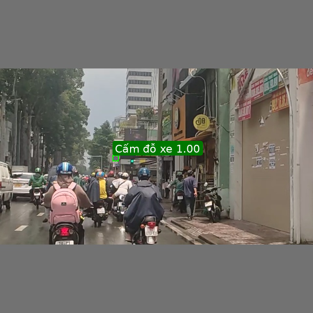
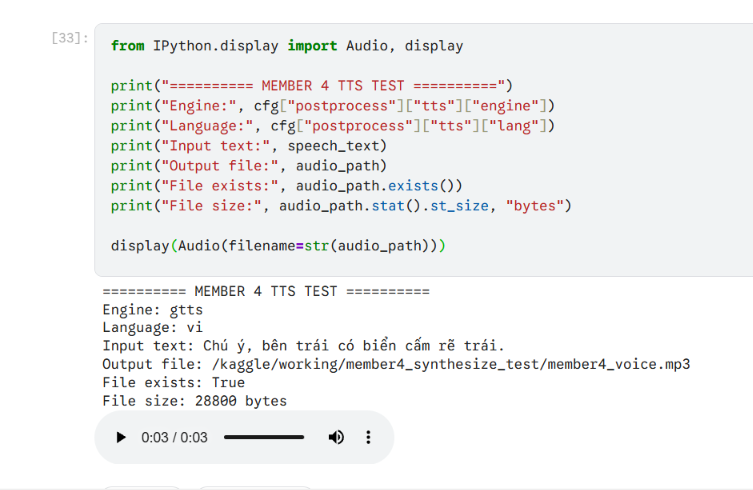

# Post-processing & Voice Alert

Tài liệu mô tả các chức năng xác định vị trí, hiển thị detection, chống cảnh báo trùng lặp, tổng hợp giọng nói và ghép âm thanh vào video trong hệ thống VN-TSD-Voice-Alert.

**Phụ trách:** Thành viên 4 – Layer & Voice.

**Phạm vi mã nguồn:** `ts_alert/postprocess/` và các thành phần realtime liên quan trong `ts_alert/runtime/`.

## 1. Tổng quan kiến trúc

Các chức năng của Thành viên 4 được sử dụng trong hai luồng riêng: xử lý media sau khi tải lên (offline/batch) và xử lý video/camera realtime.

| Module | Vai trò |
| --- | --- |
| `postprocess/position.py` | Xác định vị trí trái, trước hoặc phải của biển báo |
| `postprocess/draw_layer.py` | Vẽ bounding box, nhãn và confidence lên frame |
| `postprocess/dedup.py` | Chống phát lại cảnh báo trùng trong pipeline xử lý media |
| `postprocess/tts.py` | Tạo câu cảnh báo và tổng hợp file âm thanh |
| `postprocess/tts_worker.py` | Xếp hàng và xử lý TTS bất đồng bộ cho realtime |
| `postprocess/merge_av.py` | Ghép các đoạn âm thanh cảnh báo vào video đầu ra |
| `runtime/tracker.py` | Theo dõi đối tượng theo thời gian trong phiên realtime |
| `runtime/realtime_service.py` | Điều phối detector, tracker, worker TTS và sự kiện realtime |

### 1.1. Luồng xử lý media (offline/batch)

Luồng chính được triển khai trong `ts_alert/pipeline.py::process_media`.

```text
Input image/video
       |
       v
Detector.predict(frame)     (video áp dụng frame_stride)
       |
       v
position.add_positions()
       |
       +------------------------------+
       |                              |
       v                              v
repo.add_detections()          Deduplicator.update()
                                      |
                                      v
                              SpeechEvent mới
                                      |
                   +------------------+------------------+
                   |                                     |
                   v                                     v
          draw_layer.draw_detections()          tts.build_speech_text()
                   |                                     |
                   v                                     v
            Frame đã vẽ                         tts.synthesize()
                                                         |
                                                         v
                                                  audio_events
                   |                                     |
                   +------------------+------------------+
                                      |
                                      v
                         merge_av.merge_audio_video()
                                      |
                                      v
                              Video kết quả
```

Các bước chính:

1. Đọc frame từ ảnh hoặc video. Với video, detector chỉ chạy ở những frame đến lượt theo `inference.frame_stride`; các frame bỏ qua có thể dùng lại detection gần nhất để hiển thị.
2. Gọi `position.add_positions()` để bổ sung vị trí cho detection.
3. Lưu detection và đưa vào `Deduplicator.update()`. Chỉ các biển báo được xem là mới sẽ tạo `SpeechEvent`.
4. Vẽ detection bằng `draw_layer.draw_detections()`.
5. Với từng `SpeechEvent`, tạo câu đọc bằng `tts.build_speech_text()`, sau đó gọi `tts.synthesize()`. Nếu một lần tổng hợp TTS lỗi, pipeline ghi log và tiếp tục xử lý các bước còn lại.
6. Với video có audio event, gọi `merge_av.merge_audio_video()` để tạo video đầu ra có âm thanh.

### 1.2. Luồng realtime

Luồng realtime được điều phối bởi `RealtimeSessionManager` trong `ts_alert/runtime/realtime_service.py`. Luồng này **không dùng Deduplicator của pipeline offline**; nó dùng `TrafficSignTracker` và `AsyncTTSWorker`.

```text
Frame decoder
     |
     v
Detector (theo frame_stride)
     |
     v
Chuẩn hóa detection + position.add_positions()
     |
     v
TrafficSignTracker
     |
     v
Track được xác nhận
     |
     v
AsyncTTSWorker.submit()
     |
     v
Tổng hợp âm thanh ở worker nền
     |
     v
Sự kiện alert / audio URL cho phiên realtime
```

Tracker được cập nhật theo từng bước frame; kết quả detector được hợp nhất vào track tương ứng. Khi track đủ điều kiện phát cảnh báo, realtime service tạo câu đọc và đưa vào hàng đợi TTS. Âm thanh realtime được lưu thành file riêng và cung cấp cho giao diện qua sự kiện/đường dẫn audio của phiên; luồng này không gọi `merge_av` để ghép audio vào file video như pipeline offline.

## 2. Chi tiết các module

### 2.1. Position – Xác định vị trí biển báo

**File:** `ts_alert/postprocess/position.py`

**Hàm chính:**

```python
get_position(bbox, frame_width, cfg) -> str
add_positions(detections, frame_width, cfg) -> list
```

Với bounding box `[x1, y1, x2, y2]`, module tính tâm ngang và tỷ lệ so với chiều rộng frame:

```text
center_x = (x1 + x2) / 2
ratio = center_x / frame_width
```

Sau đó phân loại theo `postprocess.position`:

- `ratio < left_max`: `left`.
- `left_max <= ratio < right_min`: `front`.
- `ratio >= right_min`: `right`.

`add_positions()` bổ sung khóa `position` vào từng detection và trả lại danh sách đã cập nhật.

### 2.2. Draw Layer – Vẽ bounding box và nhãn

**File:** `ts_alert/postprocess/draw_layer.py`

**Hàm chính:**

```python
draw_detections(frame, detections) -> frame
```

- Đầu vào là frame OpenCV dạng BGR và danh sách detection có bounding box, label, confidence.
- Hàm không sửa frame gốc; kết quả là một frame BGR mới. Nếu không có detection, hàm trả về bản sao của frame.
- Pillow (PIL) được dùng để vẽ chữ Unicode, giúp hiển thị tên biển báo tiếng Việt có dấu. Frame được chuyển BGR → RGB trước khi vẽ và RGB → BGR khi trả kết quả.
- Bounding box được vẽ màu xanh lá; nhãn có nền xanh đậm và chữ trắng. Nếu confidence có mặt, nhãn hiển thị confidence với hai chữ số thập phân.
- Kích thước font được điều chỉnh theo chiều cao ảnh và giảm khi nhãn quá dài.

Module tìm font theo thứ tự các đường dẫn DejaVu Sans/Noto Sans trên Linux, Arial/Segoe UI/Tahoma trên Windows và Arial trên macOS. Có thể chỉ định font riêng bằng biến môi trường `TSD_VOICE_ALERT_FONT`. Nếu không tìm được font Unicode phù hợp, hàm phát sinh `FileNotFoundError`.

### 2.3. Deduplication – Chống cảnh báo trùng lặp trong pipeline offline

**File:** `ts_alert/postprocess/dedup.py`

**Class và phương thức chính:**

```python
Deduplicator(cfg)
reset() -> None
update(detections, frame_index, timestamp_sec) -> list[SpeechEvent]
```

Mục đích là tránh đọc lặp một biển báo xuất hiện liên tiếp qua nhiều frame trong cùng media.

Nguyên tắc:

1. Mỗi track lưu nhãn, bounding box và frame cuối cùng nhìn thấy.
2. Detection mới chỉ được ghép với track có cùng `label` và IoU **lớn hơn** ngưỡng `iou_match`.
3. Mỗi track chỉ được ghép tối đa một detection trong một frame.
4. Detection ghép được với track cũ sẽ cập nhật bounding box và thời điểm nhìn thấy, không tạo cảnh báo mới.
5. Detection không ghép được tạo track mới và một `SpeechEvent`.
6. Track cũ bị loại khi khoảng cách frame vượt quá số frame cho phép.

Để tránh xóa track quá sớm khi detector không chạy ở mọi frame, số frame giữ track thực tế được tính bằng:

```python
effective_lost_frames = max(lost_frames, frame_stride)
```

Vì vậy, khi tăng `inference.frame_stride`, thời gian giữ track theo số frame cũng không thấp hơn stride đang dùng. Bộ `Deduplicator` được reset khi bắt đầu một media mới.

**Cấu hình hiện tại trong `configs/shared.yaml`:**

```yaml
inference:
  frame_stride: 1

postprocess:
  dedup:
    iou_match: 0.5
    lost_frames: 15
```

Các giá trị trên là cấu hình mặc định dùng chung; tham số có thể được override bởi cấu hình hoặc lời gọi pipeline.

### 2.4. Text-to-Speech – Tạo nội dung và tổng hợp giọng nói

**File:** `ts_alert/postprocess/tts.py`

**Hàm chính:**

```python
build_speech_text(label, position, classes, cfg=None) -> str
synthesize(text, out_path, cfg) -> Path
```

#### Tạo câu cảnh báo

`build_speech_text()` tìm thông tin lớp trong danh sách classes theo thứ tự:

1. Ưu tiên khớp chính xác tên lớp.
2. Nếu chưa khớp, thử khớp sau khi bỏ khoảng trắng hai đầu và không phân biệt chữ hoa/chữ thường.
3. Nếu lớp có `tts_text` hợp lệ, dùng nội dung này làm tên đọc; các giá trị bắt đầu bằng `TODO_` được bỏ qua.
4. Nếu không có nội dung đọc riêng, dùng tên lớp.

Template hỗ trợ các placeholder:

| Placeholder | Nội dung |
| --- | --- |
| `{position_text}` | Vị trí đã chuyển thành câu tiếng Việt |
| `{position}` | Đồng nghĩa với `{position_text}` |
| `{name}` | Tên biển báo dùng để đọc |
| `{label}` | Nhãn detection gốc |

Nếu `tts_text` của lớp chứa `{position_text}` hoặc `{position}`, nội dung đó được dùng làm template riêng cho lớp.

**Template mặc định hiện tại:**

```yaml
postprocess:
  tts:
    engine: gtts
    lang: vi
    cache_enabled: true
    template: "Chú ý, {position_text} có biển {name}"
    position_text:
      left: "bên trái"
      front: "phía trước"
      right: "bên phải"
```

Ví dụ với `label = "Cấm rẽ trái"` và `position = "left"`, câu đọc mặc định là:

```text
Chú ý, bên trái có biển Cấm rẽ trái
```

#### Tổng hợp âm thanh

Hai engine được hỗ trợ:

| Engine | Đặc điểm |
| --- | --- |
| `gtts` | Tổng hợp tiếng Việt qua dịch vụ Google Text-to-Speech; cần Internet |
| `pyttsx3` | Tổng hợp offline; voice và chất lượng phụ thuộc engine/giọng đọc của hệ điều hành |

Hàm `synthesize()` kiểm tra text không rỗng, kiểm tra engine hợp lệ, tạo thư mục output nếu cần và trả về đường dẫn file âm thanh. Engine `gtts` tạo MP3; `pyttsx3` tạo WAV.

#### Cache TTS

Cache được bật trong cấu hình dùng chung hiện tại (`postprocess.tts.cache_enabled: true`). Khi bật và xác định được thư mục cache, hệ thống:

- Tạo khóa SHA-256 từ engine, ngôn ngữ, phần mở rộng và nội dung text.
- Dùng khóa theo digest để tránh tổng hợp trùng trong các luồng của cùng tiến trình.
- Ghi vào file tạm rồi thay thế nguyên tử thành file cache.
- Sao chép file cache đến `out_path` để bên gọi có file riêng.

Nếu không cấu hình `cache_dir`, thư mục mặc định được lấy từ `paths.outputs_dir/tts_cache`. Cache giúp tránh gọi lại engine cho câu đọc đã có, nhưng không thay thế việc kiểm tra chất lượng audio thật.

### 2.5. Async TTS Worker – Hàng đợi TTS cho realtime

**File:** `ts_alert/postprocess/tts_worker.py`

**Class chính:** `AsyncTTSWorker`

Worker được dùng trong realtime service để việc tổng hợp âm thanh không chặn trực tiếp luồng điều phối frame. Các điểm chính:

- Nhận câu đọc qua `submit()` và đưa vào hàng đợi có giới hạn.
- Dùng synthesizer của module `tts.py` nếu không truyền synthesizer thay thế.
- Chống gửi trùng theo track đang được giữ chỗ, theo cặp `(class_id, position)` và theo thời gian cooldown.
- Loại bỏ cảnh báo đã quá tuổi trước hoặc sau khi tổng hợp; cảnh báo vượt timeout được đánh dấu timeout.
- Khi queue đầy, phần tử chờ cũ nhất bị loại để nhường chỗ cho cảnh báo mới.
- Giới hạn số tác vụ tổng hợp chưa kết thúc bằng semaphore; kết quả hoàn tất được chuyển cho callback của phiên.
- Cung cấp lịch sử alert gần nhất và thống kê như số đã submit, synthesized, deduped, timeout và dropped.

**Thông số realtime hiện tại trong `configs/shared.yaml`:**

| Khóa | Giá trị | Ý nghĩa |
| --- | ---: | --- |
| `tts_timeout_sec` | 3.0 s | Timeout tổng hợp |
| `tts_cooldown_sec` | 4.0 s | Thời gian cooldown cảnh báo trùng |
| `tts_max_alert_age_sec` | 2.5 s | Tuổi tối đa của cảnh báo |
| `tts_max_queue_size` | 6 | Số phần tử tối đa trong queue |
| `tts_playback_rate` | 1.8 | Tốc độ phát giọng nói realtime ở giao diện |
| `tts_compact` | `true` | Bật câu đọc rút gọn |
| `tts_compact_template` | `{position_text}, {name}` | Template câu đọc rút gọn |
| `tts_cutoff_on_pass` | `true` | Cho phép giao diện ngắt phát live khi biển báo đã đi qua |
| `tts_cutoff_grace_sec` | 0.25 s | Khoảng grace trước khi ngắt |
| `tts_cache_enabled` | `true` | Dùng cache TTS cho realtime |

Khi `tts_compact` bật, realtime service dùng template rút gọn thay cho template đầy đủ. Ví dụ câu đọc realtime có thể là `bên trái, Cấm rẽ trái`, không có tiền tố “Chú ý”.

### 2.6. TrafficSignTracker – Theo dõi biển báo trong realtime

**File:** `ts_alert/runtime/tracker.py`

**Class chính:** `TrafficSignTracker` với cấu hình `TrackerConfig`.

Tracker realtime là thành phần riêng, **không phải** `Deduplicator` của pipeline offline. Mỗi phiên video/camera có trạng thái tracker riêng; tracker được reset khi phiên cần khởi tạo lại hoặc thay đổi vị trí phát video.

Các chức năng chính:

- Gán và duy trì `track_id` cho từng biển báo.
- Quản lý trạng thái track: `tentative`, `active`, `lost`.
- Ghép detection với track dựa trên IoU và khoảng cách tâm đã chuẩn hóa; có thể xử lý thay đổi class khi bằng chứng hình học đủ mạnh.
- Dùng số lần xuất hiện và ngưỡng confidence để xác nhận track trước khi phát cảnh báo.
- Ước lượng vận tốc của bounding box để hỗ trợ dự đoán vị trí.
- Có thể dùng Sparse Lucas–Kanade optical flow trên ảnh xám thu nhỏ để bù chuyển động giữa các lần detector chạy. Khi optical flow không đủ dữ liệu hoặc thất bại, tracker có thể dùng ước lượng vận tốc làm phương án thay thế.
- Áp dụng TTL, thời gian Re-ID và giới hạn extrapolation/staleness để loại track cũ hoặc khôi phục track còn trong thời gian cho phép.
- Tạo sự kiện track mất dấu để realtime service cập nhật trạng thái phiên.

Trong realtime service hiện tại, optical flow được bật cho cả YOLO và Faster R-CNN. Các giá trị TTL/extrapolation được cấu hình riêng theo model trong `RealtimeSessionManager`; không nên xem chúng là cùng một tham số với `postprocess.dedup.lost_frames`.

**Lưu ý:** Optical flow chỉ ước lượng chuyển động của bounding box từ các đặc trưng ảnh còn nhìn thấy. Nó không khôi phục pixel bị che khuất và không thay thế detector.

### 2.7. Merge Audio-Video – Ghép âm thanh vào video

**File:** `ts_alert/postprocess/merge_av.py`

**Hàm chính:**

```python
merge_audio_video(video_path, audio_events, out_path) -> Path
```

Mỗi audio event có dạng:

```python
{
    "audio_path": Path("alert.mp3"),
    "timestamp_sec": 2.5,
    "text": "Chú ý, bên trái có biển Cấm rẽ trái",
}
```

Cách xử lý:

1. Lấy FFmpeg binary thông qua `imageio_ffmpeg.get_ffmpeg_exe()`.
2. Với từng audio event, dùng filter `adelay` để đặt thời điểm bắt đầu theo `timestamp_sec`.
3. Dùng `amix` để trộn các đoạn audio thành một track.
4. Giữ nguyên stream video (`-c:v copy`), mã hóa audio đầu ra AAC và ghi file kết quả.
5. Nếu danh sách audio event rỗng, sao chép nội dung video đầu vào sang đường dẫn output.

## 3. Cấu hình liên quan

Các giá trị dưới đây được đối chiếu với `configs/shared.yaml` trên nhánh `main` tại thời điểm cập nhật tài liệu.

| Nhóm | Khóa | Giá trị hiện tại |
| --- | --- | ---: |
| Position | `postprocess.position.left_max` | 0.33 |
| Position | `postprocess.position.right_min` | 0.66 |
| Dedup offline | `postprocess.dedup.iou_match` | 0.5 |
| Dedup offline | `postprocess.dedup.lost_frames` | 15 |
| Offline inference | `inference.frame_stride` | 1 |
| Realtime TTS | `realtime.tts_timeout_sec` | 3.0 s |
| Realtime TTS | `realtime.tts_cooldown_sec` | 4.0 s |
| Realtime TTS | `realtime.tts_max_alert_age_sec` | 2.5 s |
| Realtime TTS | `realtime.tts_max_queue_size` | 6 |
| Realtime TTS | `realtime.tts_playback_rate` | 1.8 |

**Phân biệt stride:** `inference.frame_stride` trong shared config là mặc định của pipeline xử lý media. Khi khởi tạo video realtime, `RealtimeSessionManager.start_video_session()` có thể dùng stride riêng theo model nếu caller không truyền giá trị: mặc định 12 cho YOLO và 20 cho Faster R-CNN. Vì vậy, không suy ra stride realtime từ riêng giá trị `inference.frame_stride`.

## 4. Kiểm thử

Các nhóm kiểm thử liên quan gồm:

| File test | Nội dung |
| --- | --- |
| `tests/test_position.py` | Phân loại vị trí trái/trước/phải |
| `tests/test_draw_layer.py` | Vẽ bounding box, nhãn và xử lý frame |
| `tests/test_dedup.py` | Ghép track, chống cảnh báo trùng và xử lý frame stride |
| `tests/test_tts.py` | Xây dựng nội dung cảnh báo, engine và cache TTS |
| `tests/test_merge_av.py` | Lệnh FFmpeg và ghép audio-video |
| `tests/test_pipeline_flow.py` | Luồng xử lý media với các thành phần được mock |
| `tests/test_realtime_runtime.py` | Tracker, phiên realtime, sự kiện và audio runtime |

Chạy toàn bộ test từ thư mục gốc repository:

```bash
python -m pytest -q
```

Một bộ test PASS xác nhận các assertion đã được kiểm tra trong môi trường test. Một số bài test dùng mock hoặc dữ liệu tổng hợp; kết quả đó không tự động chứng minh chất lượng giọng đọc, độ chính xác tracking hoặc khả năng xử lý mọi video thực tế.

## 5. Kiểm thử thực tế cần lưu bằng chứng

Để bổ sung bằng chứng cho báo cáo, nên lưu:

1. Ảnh/frame có bounding box và nhãn tiếng Việt hiển thị đúng.
2. File audio được tạo bằng gTTS hoặc pyttsx3 và câu đọc nghe rõ.
3. Video đầu ra offline có audio bắt đầu gần timestamp của detection.
4. Phiên realtime có sự kiện cảnh báo và audio tương ứng; kiểm tra cả trường hợp cảnh báo stale hoặc track đã đi qua.
5. Log hoặc ảnh chụp màn hình kết quả `pytest` kèm thời điểm chạy.

Khi kiểm tra gTTS, cần bảo đảm môi trường có Internet. Khi kiểm tra pyttsx3, cần kiểm tra voice engine có sẵn trên hệ điều hành. Khi kiểm tra ghép AV, cần dùng video/audio thật có thể giải mã được bằng FFmpeg.

## 6. Dependencies

| Thư viện/công cụ | Vai trò |
| --- | --- |
| OpenCV | Đọc/xử lý frame và hỗ trợ optical flow |
| NumPy | Xử lý mảng ảnh và tọa độ |
| Pillow (PIL) | Vẽ nhãn Unicode tiếng Việt |
| gTTS | Tổng hợp giọng nói online |
| pyttsx3 | Tổng hợp giọng nói offline |
| imageio-ffmpeg / FFmpeg | Ghép audio-video |
| pytest | Kiểm thử tự động |

Phiên bản dependencies được quản lý trong `requirements.txt`.

## 7. Kết quả minh họa

### 7.1. Bounding Box Visualization

Kết quả minh họa chức năng xác định vị trí và vẽ bounding box trên ảnh biển báo từ tập dữ liệu đã tiền xử lý.



*Ghi chú: Bounding box trong hình được chuyển đổi từ nhãn Ground Truth của dataset, không phải kết quả dự đoán của mô hình.*

### 7.2. Vietnamese Text-to-Speech

Kết quả tạo file âm thanh tiếng Việt bằng gTTS từ câu cảnh báo do module `tts.py` xây dựng.



*Ghi chú: Âm thanh được tạo trên Kaggle Notebook với Internet được bật.*
