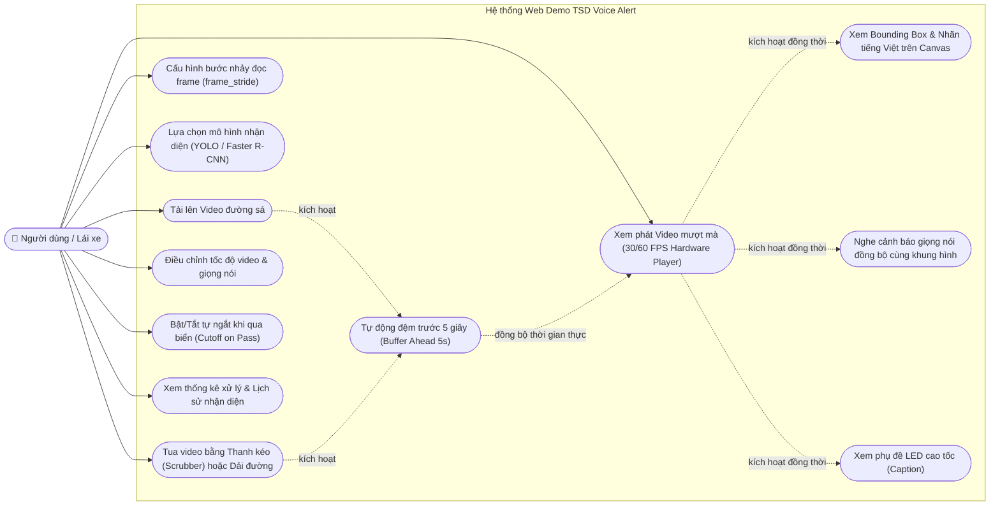
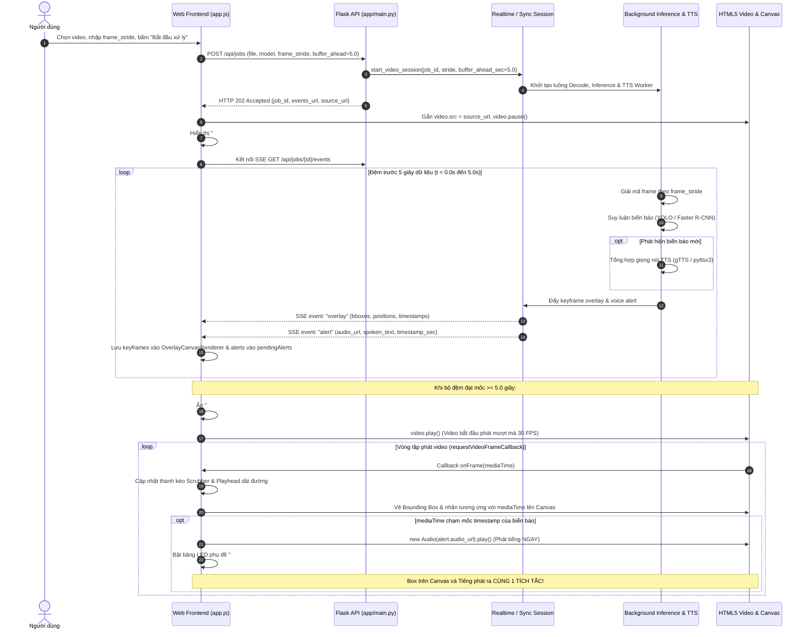
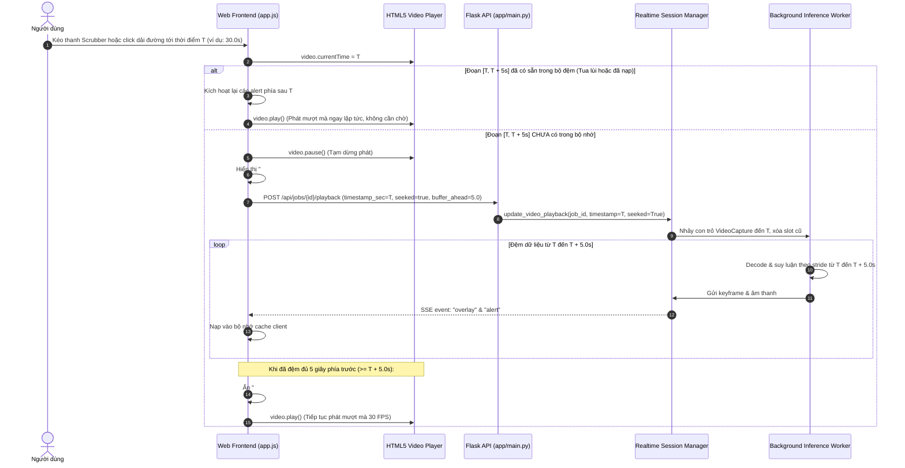

# Sơ đồ Kiến trúc & Thiết kế Hệ thống Web Demo (System Diagrams)

Tài liệu này mô tả chi tiết thiết kế kiến trúc của hệ thống **TSD Voice Alert Web Demo** thông qua 4 sơ đồ chuẩn UML (Mermaid format):
1. **Use Case Diagram** (Sơ đồ ca sử dụng)
2. **Sequence Diagram** (Sơ đồ tuần tự: Khởi tạo đệm 5s & Tua video)
3. **Activity Diagram** (Sơ đồ hoạt động: Luồng xử lý và đồng bộ)
4. **Class Diagram** (Sơ đồ lớp: Kiến trúc hướng đối tượng Frontend & Backend)

---

## 1. Use Case Diagram (Sơ đồ ca sử dụng)

Mô tả các tương tác chính giữa **Người dùng (Người lái xe / Người vận hành)** và **Hệ thống TSD Voice Alert Web Demo**.



---

## 2. Sequence Diagram (Sơ đồ tuần tự)

### 2.1. Luồng Khởi tạo Job, Đệm trước 5s & Phát đồng bộ

Mô tả chuỗi tương tác từ lúc người dùng tải video lên, hệ thống tự động đệm trước 5 giây dữ liệu trong nền, và phát đồng thời Bounding Box + Giọng nói khi video chạy tới từng biển báo.



---

### 2.2. Luồng Kéo Tua Video & Đệm 5s tại vị trí mới (Seek Flow)

Mô tả cơ chế khi người dùng kéo thanh Scrubber hoặc nhấp vào dải đường `#road` để tua video.



---

## 3. Activity Diagram (Sơ đồ hoạt động luồng xử lý)

Mô tả dòng chảy hoạt động song song giữa luồng giao diện người dùng (Frontend Hardware Playback) và luồng suy luận đệm dữ liệu (Backend Inference & TTS Buffering).

```mermaid
flowchart TD
    Start([Bắt đầu]) --> Upload[Người dùng tải video & chọn frame_stride]
    Upload --> InitJob[Backend tạo Job & khởi tạo phiên xử lý]
    InitJob --> ForkParallel{Phân luồng song song}

    %% Nhánh Backend Worker
    ForkParallel -->|Luồng Backend| ReadClock[Lấy mốc playhead hiện tại]
    ReadClock --> ReadFrame[Đọc frame tiếp theo theo frame_stride]
    ReadFrame --> CheckAhead{Khoảng cách tới playhead?}
    CheckAhead -->|> 5.0s| WaitAhead[Tạm dừng chờ video phát tới - wait_ahead]
    WaitAhead --> ReadClock
    CheckAhead -->|< 0s trễ quá 1.5s| SkipBehind[Nhảy cóc bắt kịp playhead - skip_behind]
    SkipBehind --> ReadClock
    CheckAhead -->|Trong khoảng [0s, 5s]| RunModel[Chạy suy luận YOLO / Faster R-CNN]

    RunModel --> CalcPos[Xác định vị trí làn đường: Trái / Trước / Phải]
    CalcPos --> TrackDedup[Theo dõi đối tượng & Chống lặp cảnh báo]
    TrackDedup --> NewSign{Có biển báo mới?}
    NewSign -->|Có| GenTTS[Gọi TTS tổng hợp file giọng nói MP3/WAV]
    NewSign -->|Không| EmitSSE
    GenTTS --> EmitSSE[Gửi SSE event: overlay & alert về Frontend]
    EmitSSE --> CheckEOF{Hết video?}
    CheckEOF -->|Chưa| ReadClock
    CheckEOF -->|Hết| SendDone[Gửi SSE event: done]
    SendDone --> EndBackend([Kết thúc Backend])

    %% Nhánh Frontend Client
    ForkParallel -->|Luồng Frontend| InitPlayer[Gắn video.src, video.pause, mở SSE]
    InitPlayer --> ShowBuffering[Hiện thông báo: Đang đệm 5s dữ liệu...]
    ShowBuffering --> RecvSSE[Nhận overlay & alert từ SSE nạp vào bộ nhớ]
    RecvSSE --> BufferCheck{Đã đệm đủ 5s phía trước?}
    BufferCheck -->|Chưa đủ| RecvSSE
    BufferCheck -->|Đã đủ 5s| HideBuffering[Ẩn thông báo đệm, gọi video.play]

    HideBuffering --> RVFC[Vòng lặp requestVideoFrameCallback: mediaTime]
    RVFC --> RenderOverlay[OverlayCanvasRenderer vẽ Bounding Box lên Canvas]
    RenderOverlay --> CheckAlertMatch{mediaTime chạm mốc timestamp của biển báo?}
    CheckAlertMatch -->|Đúng| PlayVoice[Kích hoạt audio.play & bật bảng LED phụ đề]
    CheckAlertMatch -->|Chưa| UpdateScrubber
    PlayVoice --> UpdateScrubber[Cập nhật giá trị thanh Scrubber & Playhead dải đường]

    UpdateScrubber --> UserSeek{Người dùng kéo thanh tua?}
    UserSeek -->|Có| DoSeek[Nhảy video.currentTime = T & Gửi POST playback]
    DoSeek --> BufferCheck
    UserSeek -->|Không| CheckVideoEnd{Video kết thúc?}
    CheckVideoEnd -->|Chưa| RVFC
    CheckVideoEnd -->|Đã hết| ShowDoneUI[Hiện kết quả hoàn tất & bảng tổng hợp]
    ShowDoneUI --> EndFrontend([Kết thúc Frontend])
```

---

## 4. Class Diagram (Sơ đồ lớp kiến trúc)

Mô tả cấu trúc lớp hướng đối tượng (OOP) của cả tầng Frontend (JavaScript) và tầng Backend (Python).

```mermaid
classDiagram
    %% Frontend Classes
    class OverlayCanvasRenderer {
        +HTMLVideoElement video
        +HTMLCanvasElement canvas
        +CanvasRenderingContext2D ctx
        +Array keyframes
        +number generation
        +boolean active
        +start() void
        +stop() void
        +destroy() void
        +addKeyframe(kf) void
        +renderAtTime(mediaTime) void
        +updateDimensions() void
        +clear() void
    }

    class AppState {
        +number jobId
        +Object job
        +EventSource eventsSource
        +Array events
        +Array detections
        +Array pendingAlerts
        +number maxBufferedSec
        +boolean isBuffering
        +number bufferAheadSec
        +number videoPlaybackRate
        +number voicePlaybackRate
        +boolean cutoffOnPass
    }

    class UIControllers {
        +setupUpload() void
        +uploadFile(formData) void
        +startRealtimeVideoSession(job) void
        +handleSSEOverlay(data) void
        +handleSSEAlert(ev) void
        +handleSSEStatus(jobId, data) void
        +seekTo(targetSec) void
        +renderEvents(isVideo) void
        +drawMarkers() void
        +showLiveCaption(text) void
    }

    OverlayCanvasRenderer <-- UIControllers : sử dụng
    AppState <-- UIControllers : quản lý trạng thái

    %% Backend Classes (ts_alert/runtime)
    class RealtimeSessionManager {
        -dict _video_sessions
        -dict _model_locks
        +start_video_session(job_id, input_path, model, stride, buffer_ahead_sec) dict
        +update_video_playback(job_id, timestamp, seeked, mode, buffer_ahead_sec) dict
        +cancel_video_session(job_id) bool
        +shutdown(wait) void
    }

    class VideoSession {
        +int key
        +string model_name
        +dict cfg
        +int frame_stride
        +float fps
        +VideoPlaybackClock clock
        +TrafficSignTracker tracker
        +AsyncTTSWorker tts_worker
        +CancellationToken cancel_token
    }

    class VideoPlaybackClock {
        -float _playhead_sec
        -int _generation
        -string _mode
        -float _buffer_ahead_sec
        +update(timestamp, playing, seeked, mode, buffer_ahead_sec) int
        +snapshot() dict
        +estimated_playhead_sec() float
    }

    class TrafficSignTracker {
        +TrackerConfig config
        +dict classes
        +update(detections, frame_idx, timestamp_sec) list
        +get_stats() dict
    }

    class AsyncTTSWorker {
        +start() void
        +enqueue(speech_event, generation) void
        +drain_pending() void
        +reset_dedup() void
        +get_stats() dict
    }

    class SynchronizedPipeline {
        +Detector detector
        +dict cfg
        +dict classes
        +ResultStore store
        +Path audio_dir
        +TrafficSignAnnotator annotator
        +process_video(job_id, video_path, frame_stride) Iterator~SynchronizedFrame~
    }

    class VideoFrameSource {
        +Path path
        +int total_frames
        +float fps
        +iter_frames(stride, cancel_token) Iterator~tuple~
        +close() void
    }

    class TrafficSignAnnotator {
        +annotate(frame, detections) Frame
        +to_jpeg(frame, quality) bytes
        +jpeg_to_base64(jpeg_bytes) string
    }

    class VoiceAlertManager {
        +dict cfg
        +dict classes
        +ResultStore store
        +Path audio_dir
        +int job_id
        +update(detections, frame_index, timestamp_sec) list~VoiceAlert~
    }

    class ResultStore {
        <<interface>>
        +create_job(input_type, input_path, model_name) int
        +set_status(job_id, status) void
        +add_detections(job_id, frame_index, timestamp_sec, detections) void
        +add_voice_event(job_id, detection_id, text, timestamp_sec, audio_path) void
        +finish_job(job_id, metrics) void
        +fail_job(job_id, error_message) void
    }

    class Repository {
        +string db_path
        +_initialize() void
        +_connect() sqlite3.Connection
    }

    class InMemoryStore {
        -dict _jobs
        -list _detections
        -list _voices
    }

    RealtimeSessionManager "1" *-- "many" VideoSession : quản lý
    VideoSession "1" *-- "1" VideoPlaybackClock : đồng bộ nhịp
    VideoSession "1" *-- "1" TrafficSignTracker : bám vết
    VideoSession "1" *-- "1" AsyncTTSWorker : sinh giọng nói
    
    SynchronizedPipeline "1" *-- "1" VideoFrameSource : đọc video
    SynchronizedPipeline "1" *-- "1" TrafficSignAnnotator : vẽ box
    SynchronizedPipeline "1" *-- "1" VoiceAlertManager : xử lý TTS

    ResultStore <|.. Repository : thực thi SQLite
    ResultStore <|.. InMemoryStore : thực thi RAM
    SynchronizedPipeline --> ResultStore : lưu kết quả
    RealtimeSessionManager --> ResultStore : lưu kết quả
```



---

## 5. Tóm tắt Nguyên lý Vận hành Hệ thống

| Thành phần | Công nghệ / Triển khai | Chức năng chính |
| :--- | :--- | :--- |
| **Player Video** | Thẻ `<video id="result-video">` (HTML5 Native) | Giải mã phần cứng GPU mượt mà 30/60 FPS, không lag, không giật. |
| **Overlay Layer** | `<canvas id="overlay-canvas">` + `requestVideoFrameCallback` | Vẽ Bounding Box, nhãn tiếng Việt và độ tin cậy đồng bộ theo từng khung hình. |
| **Bộ đệm 5 giây** | `buffer_ahead_sec = 5.0` (Backend `decide_video_frame_action`) | AI luôn chạy trước đầu đọc video 5 giây để nhận diện và tổng hợp sẵn âm thanh. |
| **Đồng bộ Âm thanh** | `pendingAlerts` + Kiểm tra mốc `mediaTime` | Giọng nói và Bounding Box kích hoạt **cùng một tích tắc** khi video chạy tới biển báo. |
| **Thanh kéo Scrubber**| `<input type="range" id="video-scrubber">` & `#road` | Cho phép người dùng tua nhanh đến bất kỳ thời điểm nào; tự động đệm 5s tại vị trí mới. |
| **Kiến trúc Lập trình**| OOP (Python Backend & JavaScript Client) | Tách biệt rành mạch các thành phần: Xử lý video, Suy luận AI, Theo dõi vết, Tổng hợp âm thanh, Kết xuất Canvas. |
